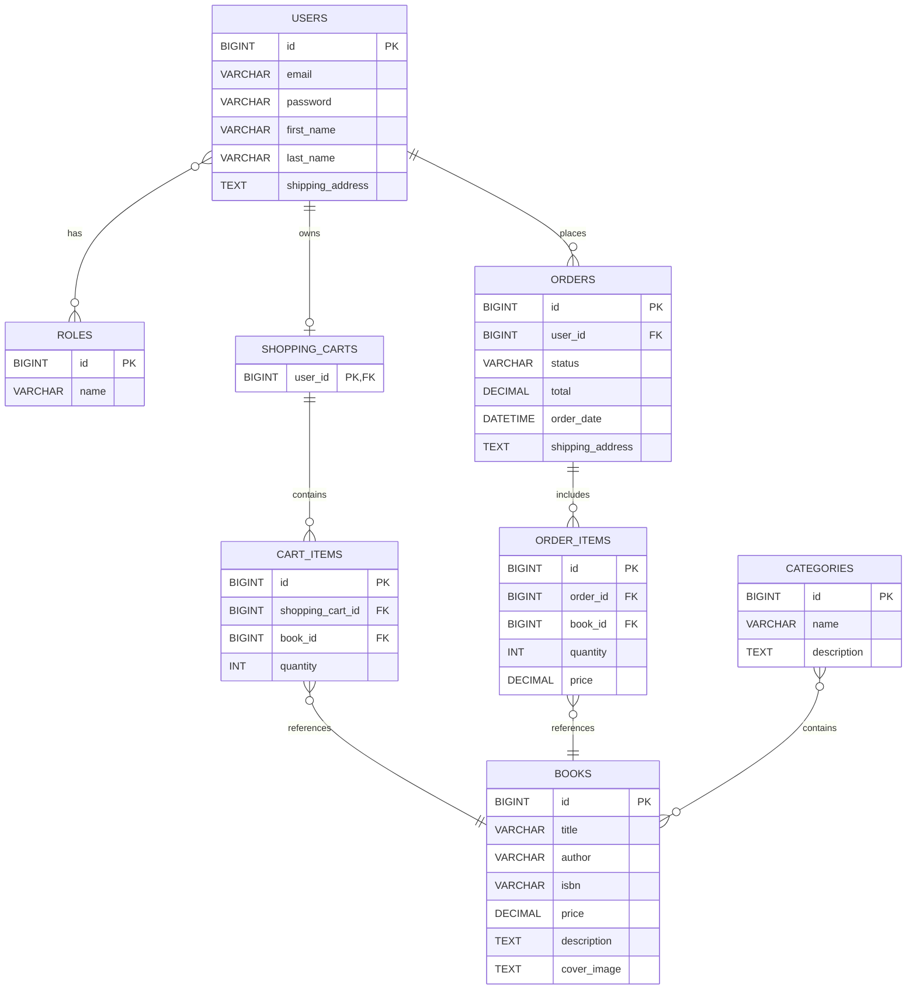

# 📚 BookNest — Online Bookstore API

Finding and managing books online should be simple, convenient, and accessible. BookNest is a backend application designed to provide the foundation for a modern online bookstore, where users can explore a book catalog and manage bookstore operations through a secure and well-structured REST API.

Built with **Java 17** and **Spring Boot 3.5.6**, this project demonstrates how to develop a reliable and maintainable backend using layered architecture, relational database persistence, JWT-based authentication, and role-based authorization.

BookNest combines essential backend development practices to create a scalable foundation for an online bookstore, focusing on clean code organization, secure access control, and efficient data management.

---

## 📑 Table of Contents

- [About the Project](#-about-the-project)
- [Features](#-features)
- [User Roles](#-user-roles)
- [Tech Stack](#tech-stack)
- [Architecture](#architecture)
- [Database Schema](#database-schema)
- [Controller Responsibilities](#-controller-responsibilities)
- [API Endpoints](#-api-endpoints)
- [Authentication and Authorization](#-authentication-and-authorization)
- [Getting Started](#-getting-started)
- [Docker Compose](#-docker-compose)
- [API Documentation](#-api-documentation)
- [Testing](#-testing)
- [Challenges and Solutions](#-challenges-and-solutions)
- [BookNest Demo](#-booknest-demo)

---

## 🎯 About the Project

**BookNest** demonstrates backend development with Spring Boot, covering book discovery, categories, shopping carts, and order processing.

### Project Goals

- Develop a RESTful API.
- Implement JWT authentication and role-based access.
- Apply layered architecture and DTO mapping.
- Integrate database persistence and Liquibase migrations.
- Support API documentation and automated testing.

---

## ✨ Features

- 🔐 **Authentication** — registration, login, and JWT.
- 📚 **Book Management** — search and manage books.
- 🗂️ **Categories** — manage, browse categories and their books.
- 🛒 **Shopping Cart** — add, update, and remove items.
- 📦 **Orders** — place orders, view history, and manage statuses.
- 💾 **Persistence** — Spring Data JPA and Hibernate.
- 🔄 **Migrations** — Liquibase.
- 🧩 **DTO Mapping** — MapStruct.
- 📖 **API Documentation** — Swagger UI.
- 🧪 **Testing** — JUnit, Testcontainers, MockMvc and Mockito.
- 🐳 **Docker** — Docker Compose.

---

## 👥 User Roles

| Role | Permissions |
|---|---|
| `USER` | Browse books and categories, manage a cart, and access personal orders. |
| `ADMIN` | Manage books and categories and perform authorized order operations. |

Actual permissions depend on the Spring Security configuration.

---

<a id="tech-stack"></a>

## 💻 Tech Stack

| Technology | Purpose |
|---|---|
| Java 17, Spring Boot 3.5.6 | Core application |
| Spring Web | REST API |
| Spring Security, JWT | Authentication and authorization |
| Spring Data JPA, Hibernate | Persistence and ORM |
| MySQL / H2 | Database options |
| Liquibase | Database migrations |
| MapStruct, Lombok | Mapping and boilerplate reduction |
| Maven | Build management |
| OpenAPI / Swagger | API documentation |
| JUnit, Mockito | Testing |
| Checkstyle | Code style and static analysis |
| Docker Compose | Containerization |

---

<a id="architecture"></a>

## 🏗️ Architecture

BookNest separates request handling, business logic, data access, and persistence into distinct layers.

### Architecture Diagram

```text
REST Client (Browser / Postman)
              |
              ▼
    Spring Security / JWT
              |
              ▼
         Controllers
              |
              ▼
        Service Layer
              |
              ▼
       DTOs / Mappers
              |
              ▼
       Repositories
              |
              ▼
      Database (MySQL / H2)
       Liquibase Migrations
```

### Architectural Layers

| Layer | Responsibility |
|---|---|
| Controllers | Handle HTTP requests and responses. |
| Security | Authenticate users and enforce access rules. |
| Services | Implement business logic. |
| DTOs / Mappers | Separate API models from entities. |
| Repositories | Access data through Spring Data JPA. |
| Database / Liquibase | Store data and manage schema changes. |

---

<a id="database-schema"></a>

## 🗄️ Database Schema

The ER diagram represents the intended data model. Verify it against the JPA entities and Liquibase changelogs.

### Entity Relationship Diagram



### Database Tables

| Table | Description |
|---|---|
| `users` | User accounts and shipping details. |
| `roles` | User roles. |
| `books` | Book details, prices, and descriptions. |
| `categories` | Book categories. |
| `shopping_carts` | User shopping carts. |
| `cart_items` | Cart books and quantities. |
| `orders` | Order details, status, and shipping address. |
| `order_items` | Ordered books, quantities, and purchase prices. |

### Entity Relationships

- Users can have multiple roles.
- Each user owns a shopping cart.
- Carts contain items referencing books.
- Books and categories have a many-to-many relationship.
- Users can place multiple orders, each containing order items.
- Order items store the purchase price to preserve historical pricing.

---

## 🧭 Controller Responsibilities

| Controller | Responsibility |
|---|---|
| `AuthController` | Registration and login. |
| `BookController` | Retrieve, search, create, update, and delete books. |
| `CategoryController` | Retrieve categories and browse their books. |
| `ShoppingCartController` | Manage the current user's cart. |
| `OrderController` | Create orders, retrieve history, and manage statuses. |

---

## 🌐 API Endpoints


### 🔐 Authentication

| Method | Endpoint | Description | Access |
|---|---|---|---|
| `POST` | `/api/auth/registration` | Register a new user | Public |
| `POST` | `/api/auth/login` | Log in and obtain a JWT token | Public |

### 📚 Books

| Method | Endpoint | Description | Access |
|---|---|---|---|
| `GET` | `/api/books` | Get all books | `USER` |
| `GET` | `/api/books/{id}` | Get book by id | `USER` |
| `GET` | `/api/books/search` | Search books | `USER` |
| `POST` | `/api/books` | Create a book | `ADMIN` |
| `PUT` | `/api/books/{id}` | Update a book | `ADMIN` |
| `DELETE` | `/api/books/{id}` | Delete a book | `ADMIN` |

### 🗂️ Categories

| Method | Endpoint | Description | Access |
|---|---|---|---|
| `GET` | `/api/categories` | Get all categories | `USER` |
| `GET` | `/api/categories/{id}/books` | Get books by category ID | `USER` |
| `GET` | `/api/categories/{id}` | Get category by id | `USER` |
| `POST` | `/api/categories` | Create a category | `ADMIN` |
| `PUT` | `/api/categories/{id}` | Update a category by id | `ADMIN` |
| `DELETE` | `/api/categories/{id}` | Delete a category by id | `ADMIN` |

### 🛒 Shopping Cart

| Method | Endpoint | Description | Access |
|---|---|---|---|
| `GET` | `/api/cart` | Get the current user's shopping cart | `USER` |
| `POST` | `/api/cart` | Add book to the shopping cart | `USER` |
| `PUT` | `/api/cart/items/{cartItemId}` | Update quantity of the book in the shopping cart | `USER` |
| `DELETE` | `/api/cart/items/{cartItemId}` | Delete the cart item from the shopping cart | `USER` |

### 📦 Orders

| Method | Endpoint | Description | Access |
|---|---|---|---|
| `POST` | `/api/orders` | Complete an order | `USER` |
| `GET` | `/api/orders` | Get order history | `USER` |
| `PATCH` | `/api/orders/{id}` | Update order status | `ADMIN` |
| `GET` | `/api/orders/{orderId}/items` | Get order items | `USER` |
| `GET` | `/api/orders/{orderId}/items/{itemId}` | Get order item by order id and order item id | `USER` |

### 🧪 API Usage Examples

Examples assume the application runs on `http://localhost:8088`.

#### Retrieve Books

```bash
curl -X 'GET' \
  'http://localhost:8088/api/books?page=0&size=20' \
  -H 'accept: */*' \
  -H 'Authorization: Bearer YOUR_JWT_TOKEN'
  
```

#### Log In

```bash
curl -X POST \
  'http://localhost:8088/api/auth/login' \
  -H 'accept: */*' \
  -H 'Authorization: Bearer YOUR_JWT_TOKEN' \
  -H 'Content-Type: application/json' \
  -d '{
    "email": "user@example.com",
    "password": "your_password"
  }'
```

#### Retrieve the Shopping Cart

```bash
curl -X 'GET' \
  'http://localhost:8088/api/cart' \
  -H 'accept: */*' \
  -H 'Authorization: Bearer YOUR_JWT_TOKEN'  
```

---

## 🔐 Authentication and Authorization

BookNest uses JWT to authenticate requests to protected endpoints.

### Authentication Flow

1. Register an account.
2. Log in and obtain a JWT.
3. Send the token in the `Authorization` header.

```http
Authorization: Bearer <JWT_TOKEN>
```

### Authorization Rules

- Public access depends on the security configuration.
- Authenticated users can access permitted resources.
- Administrative operations require appropriate permissions.


---

## 🚀 Getting Started

### Prerequisites

- JDK 17
- Maven 3.8+
- Git
- Docker

Check installed versions:

```bash
java -version
mvn -version
git --version
```

### 1. Clone the Repository

```bash
git clone https://github.com/kvjohnny/Spring-Boot-intro.git
cd spring-boot-intro
```

### 2. Configure the Database

Example MySQL configuration:

```properties
spring.datasource.url=${DB_URL:jdbc:mysql://localhost:3306/book?serverTimezone=UTC}
spring.datasource.username=${DB_USERNAME:root}
spring.datasource.password=${DB_PASSWORD}
```

Set the environment variables:

```bash
export DB_USERNAME=root
export DB_PASSWORD=your_password
```

### 3. Build the Application

```bash
mvn clean verify
```

Alternatively, use Maven Wrapper if available:

```bash
./mvnw clean verify
```

On Windows:

```powershell
.\mvnw.cmd clean verify
```

### 4. Run the Application

```bash
mvn spring-boot:run
```

Or, using Maven Wrapper:

```bash
./mvnw spring-boot:run
```

Default application URL: http://localhost:8088

---

## 🐳 Docker Compose

Start the application with:

```bash
docker compose up --build
```

Run in the background:

```bash
docker compose up --build -d
```

Stop the services:

```bash
docker compose down
```

Remove named volumes and their persisted data:

```bash
docker compose down --volumes
```

---

## 📖 API Documentation

If Swagger UI is enabled, open:

http://localhost:8088/api/swagger-ui/index.html

Use it to explore endpoints, inspect schemas, and test API requests. The URL may depend on the application configuration.

---

## 🧪 Testing

Run the tests:

```bash
mvn test
```

Run the complete verification lifecycle:

```bash
mvn clean verify
```

Testing may cover service logic, persistence, security, validation, cart operations, order processing, and controller behavior.


---

## 🧩 Challenges and Solutions

### JWT Authentication and Role-Based Authorization

**Challenge:** Protecting private endpoints while allowing public access to registration and login.

**Approach:** Integrated Spring Security with JWT-based authentication and role-based access control. Protected endpoints require a valid token, while administrative operations are restricted to authorized users.

### Database Schema Evolution

**Challenge:** Keeping the database schema consistent across development and testing environments.

**Approach:** Used Liquibase changelogs to manage database schema changes in a version-controlled and repeatable way.

### Separation of Responsibilities

**Challenge:** Avoiding tightly coupled controllers, business logic, and database operations.

**Approach:** Organized the application into controller, service, and repository layers, using DTOs and MapStruct to separate API models from persistence entities.

### Integration Testing

**Challenge:** Verifying application behavior across components, including persistence and security.

**Approach:** Used the testing tools available in the project to validate business logic, API behavior, and database interactions. Integration tests were designed to provide confidence in the interaction between application layers.


---

## 🎬 BookNest Demo

[Watch the BookNest Demo](https://drive.google.com/file/d/1Cygza-WO0EbS9s2O66poamEKfy2AjIBp/view?usp=sharing)


---